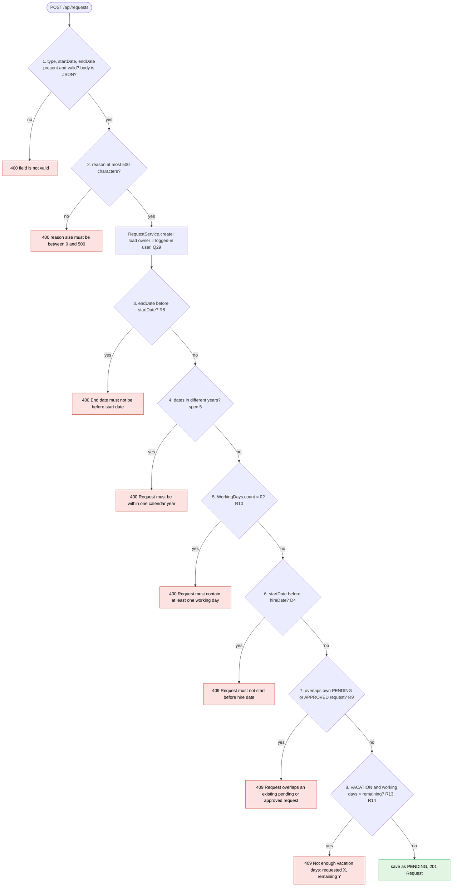
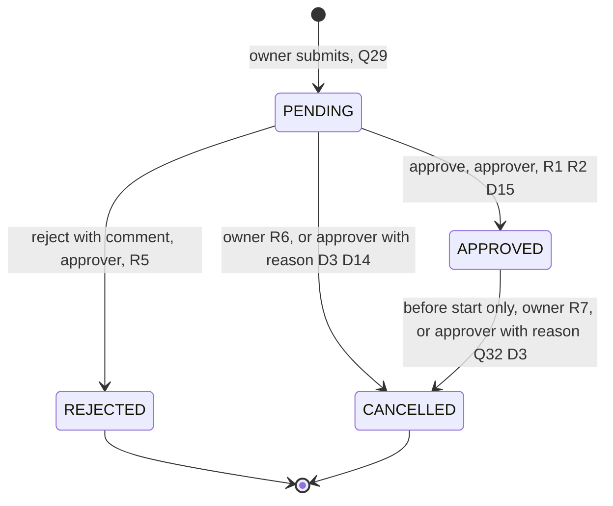
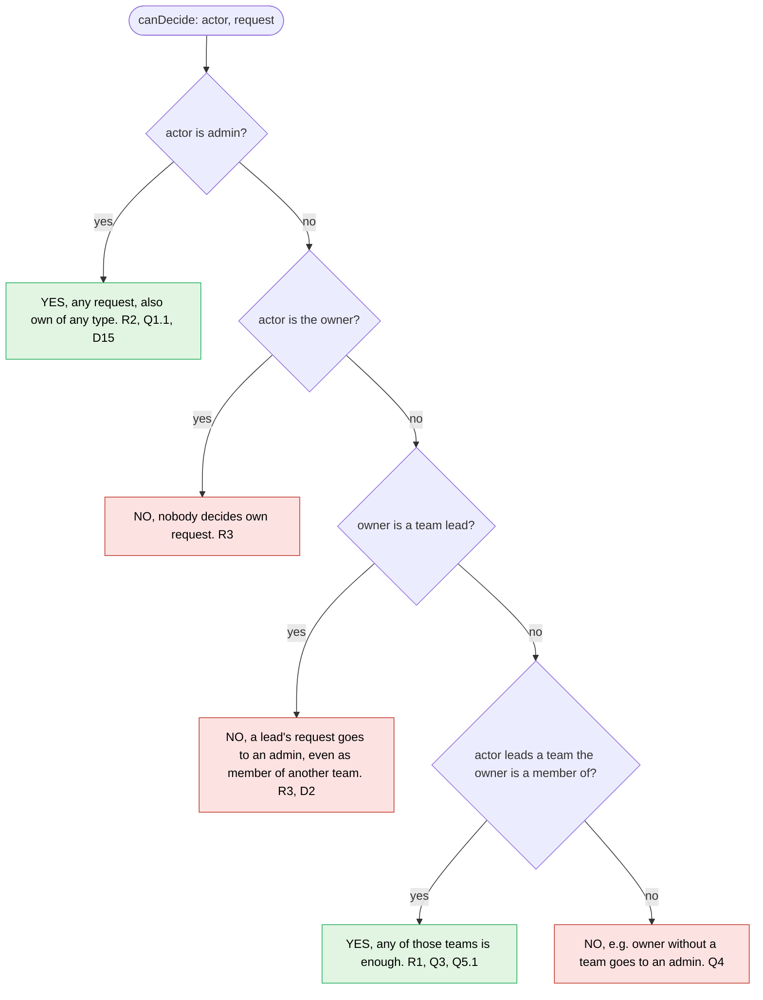
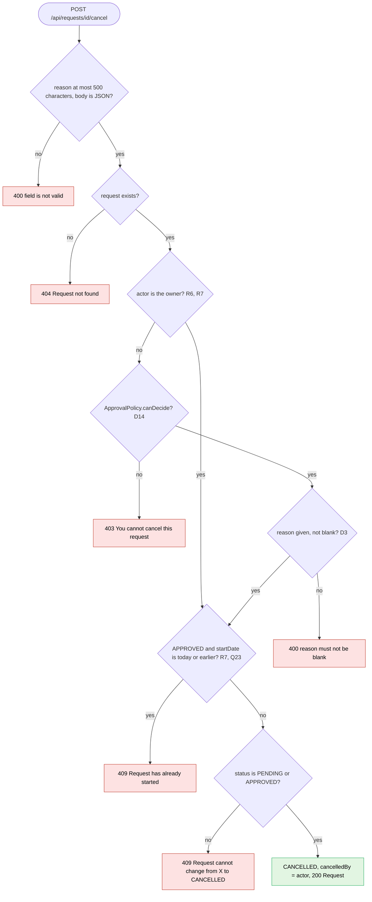
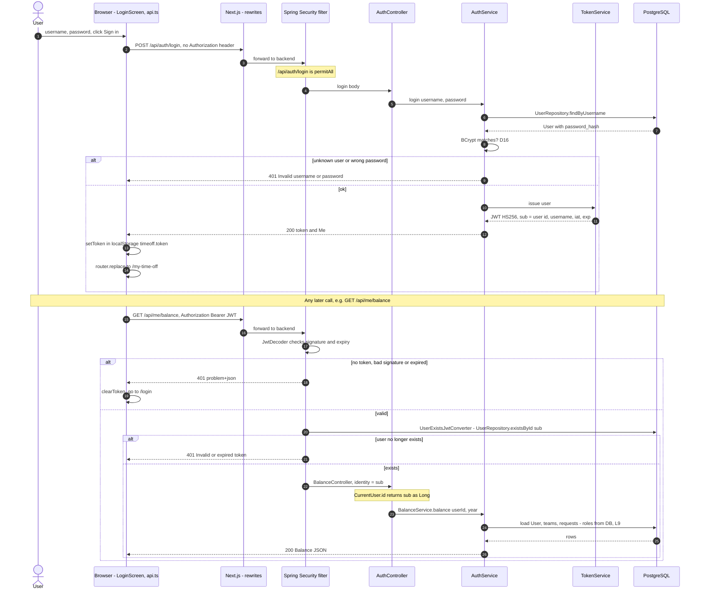
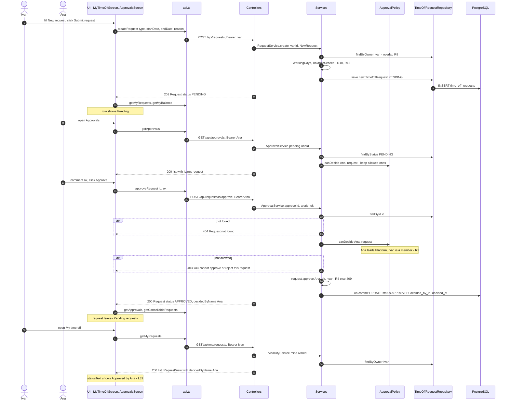
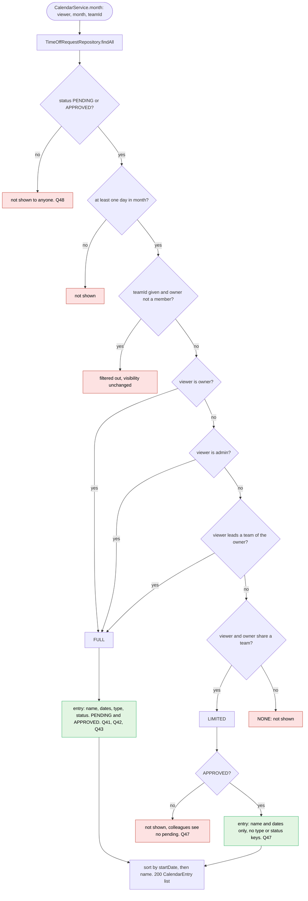

# Diagrams

Flow and sequence diagrams for the main rules and calls (Q51: no Swagger; flow diagrams and sequence diagrams). The behaviour is defined by [the specification](zajednicko/specifikacija.md); endpoint and class names come from [the interface](zajednicko/sucelje.md) and the code. GitHub renders the `mermaid` blocks.

Rule codes: `R` = rule from the brief, `Q` = answered question, `D` = our decision (specification, Decisions), `L` = coding log entry.

## 1. Creating a request

`POST /api/requests` → `RequestController.create` → `RequestService.create`. Checks run in this order and the first failure decides the answer: 400 when the body is wrong by itself, 409 when it clashes with data in the database (interface T4).

- Checks 1 and 2 are in the API (`@Valid` on `CreateRequestBody`), checks 3–8 in `RequestService`.
- R8: the end date is not before the start date. R9: no overlap with own pending or approved requests of any type; touching on an edge is an overlap. R10: only working days count; a request with none is invalid. R13: a vacation must not exceed the remaining balance of its year; pending requests use up balance. R14: sick leave and day off do not use balance. D4: a request does not start before the hire date. Q29: only the owner submits a request.

## 2. Request states

The `Status` enum allows only these transitions; anything else throws `InvalidStatusTransitionException`, which the API returns as 409 (interface T1).

- "Approver" = whoever `ApprovalPolicy.canDecide` allows (section 3).
- R4: only pending requests can be approved or rejected. R5: a rejection needs a comment, an approval comment is optional. R6: the owner can cancel a pending request. R7: the owner can cancel an approved request that has not started yet. D3: whoever cancels someone else's request must give a reason. D14: whoever may approve a request may also cancel it. Q23: a request that starts today has started.

## 3. Who may approve or reject

`ApprovalPolicy.canDecide(actor, request)`: rules are read in order and the first that applies decides; if none applies, the answer is no (interface T5). `ApprovalService` returns 403 `You cannot approve or reject this request`.

Order of checks in `ApprovalService.approve` and `reject`: request exists (404 `Request not found`) → `canDecide` (403) → state is `PENDING` (409, R4). The reject comment (400 `comment must not be blank`, R5) is checked earlier, in `ApprovalController`.

- R1: a team lead approves requests from members of their own team only. R2: an admin approves any request. R3: nobody approves their own request; a team lead's request goes to an admin. D2: a lead's request always goes to an admin. D15: an admin may approve their own request of any type. Q4: a user without a team is decided by an admin.

## 4. Cancelling

`POST /api/requests/{id}/cancel` → `CancelController.cancel` → `CancelService.cancel`. Who may cancel and whether a reason is needed comes from `CancelPolicy`, which reuses `ApprovalPolicy` (interface T6).

- The owner's reason is optional; anyone else's is required. A pending request can be cancelled even if its dates have passed: "started" is checked only for approved requests.
- R6: the owner can cancel a pending request. R7: the owner can cancel an approved request that has not started yet. Q23: a request that starts today has started. Q30, Q31, Q32: a team lead and an admin may cancel too. Q30.1, Q31.1: not once it has started. D3: someone else cancelling must give a reason. D14: whoever may approve may cancel.
- The Approvals screen lists approved requests of others that the user may still cancel with `GET /api/approvals/cancellable` (`CancelService.cancellable`, same rules, interface T8.1).

## 5. Login and an authenticated call

The browser only calls relative `/api/...` paths; Next.js forwards them to the backend (`rewrites` in `next.config.ts`). The token carries only identity; roles and teams are read from the database on every call (L9), so a change made directly in the database (D6) applies without a new login.

- In the second part `AC` and `AS` stand for the controller and service of that call (`BalanceController`, `BalanceService`); every endpoint works the same way.
- There is no server logout: `Log out` only clears the token (interface T2, T8).
- L9: the token holds only who you are; roles and teams come from the database. D6: corrections are made directly in the database. D16: seed password `password` for all users.

## 6. Ivan submits, Ana approves, Ivan sees "Approved by Ana"

One request through all layers (docs/arhitektura.md). The approval needs no explicit `save`: the request is a managed JPA entity, so the change is written as an `UPDATE` when the transaction commits.

- R1: a team lead approves requests from members of their own team. R4: only pending requests can be approved. R9: no overlapping requests. R10: only working days count. R13: a vacation must not exceed the remaining balance. L32: the request shows the name of who decided and who cancelled.

## 7. Calendar and visibility

`GET /api/calendar?month=yyyy-MM&teamId=` → `CalendarController.calendar` → `CalendarService.month`. For each request `VisibilityPolicy.access(viewer, owner)` gives `FULL`, `LIMITED` or `NONE` (rules in order, first match wins; interface T7). The same policy decides `GET /api/requests`, `GET /api/requests/{id}` and `GET /api/users/{id}/balance`, where only `FULL` is allowed.

- The frontend (`CalendarScreen`) only groups the entries by weekday; it shows `Ivan (Vacation, Pending)` for `FULL` and just `Marko` for `LIMITED`.
- A lead who is a member of another team is visible `FULL` to that team's lead, even though only an admin may approve their requests (D2 is about approving, not seeing).
- Q41: an employee sees own pending and approved requests on the calendar. Q42: a lead sees pending and approved requests of the members of the teams they lead, with type. Q43: an admin sees everyone, with a team filter. Q47: colleagues see only approved requests, name and dates. Q48: rejected and cancelled requests are shown to no one.
